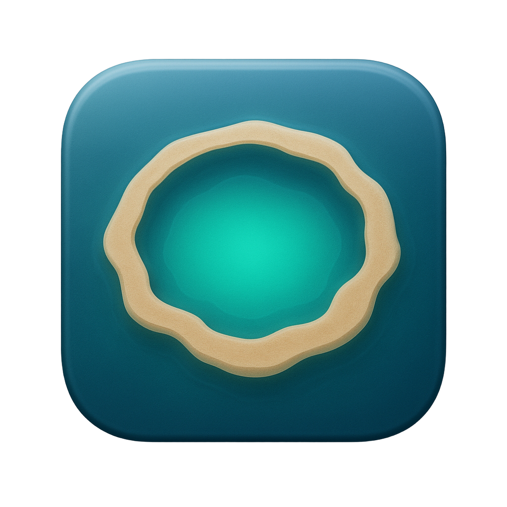

<p align="center">
	
</p>

# Contributing to IslandBoard

Thanks for wanting to improve IslandBoard! Contributions of every kind are welcome — code, design, testing, documentation and translations. This guide explains how to get set up and how to get your work merged.

IslandBoard is a fork of [Atoll](https://github.com/Ebullioscopic/Atoll). Please send bug reports and pull requests **here**, not upstream, and keep the GPL attribution headers intact in files you touch.

## Table of Contents

- [How to Contribute](#how-to-contribute)
- [Code of Conduct](#code-of-conduct)
- [Development Setup](#development-setup)
- [Pull Request Process](#pull-request-process)
- [Coding Guidelines](#coding-guidelines)
- [Design Contributions](#design-contributions)
- [Documentation](#documentation)
- [Code Review Process](#code-review-process)
- [Community & Support](#community--support)

---

## How to Contribute

1. **Fork the repository** and clone your fork locally.
2. **Create a feature branch**: `git switch -c feature/your-feature-name`
3. **Make your changes** following the guidelines below.
4. **Test your changes** so existing behaviour keeps working.
5. **Commit** with clear, descriptive messages.
6. **Push** to your fork and open a **pull request** against `main`.
7. **Join the review** and address the feedback.

## Code of Conduct

We want a welcoming, harassment-free project. Please read the
[Code of Conduct](CODE_OF_CONDUCT.md) before participating.

## Development Setup

**Requirements**

| | |
|---|---|
| **macOS** | 14.6 or later |
| **Xcode** | 16.0 or newer (Swift 5 toolchain, macOS SDK) |
| **Rust** | Stable toolchain via [rustup](https://rustup.rs); the channel is pinned by `atoll-core/rust-toolchain.toml` |
| **Hardware** | A MacBook with a notch, for full feature testing |

**Clone and open**

```bash
git clone https://github.com/RXJames/islandboard.git
cd islandboard
open DynamicIsland.xcodeproj
```

Pick your development team under *Signing & Capabilities* — the project ships without
one — then build with **⌘R**.

**Rust core (`atoll-core`)**

The app links a Rust static library. Xcode builds it automatically through the
*Build atoll-core (Rust)* phase, so a clean checkout only needs `cargo` on `PATH`. To
work on the core directly:

```bash
./atoll-core/build.sh                  # release library for the host architecture
cd atoll-core && cargo test --locked   # unit suite
```

**Build and run**

- Select *My Mac* as the run destination in Xcode.
- Build and run (**⌘R**) and grant the requested permissions.
- Quit and relaunch after granting Accessibility or Screen Recording.

## Pull Request Process

- Rebase or merge `main` before opening a PR.
- Describe what changed and why.
- Reference related issues or discussions.
- Add screenshots or a screen recording for UI changes.
- Keep the build warning-free; run the test suites you can reach.
- Respond to review feedback — stale PRs are closed after a few weeks.

## Coding Guidelines

- Follow the Swift API Design Guidelines.
- Use meaningful names and keep functions focused.
- Document public APIs and non-obvious logic inline.
- Add unit tests for new behaviour where practical; UI tests live in `DynamicIslandUITests`.
- Avoid new dependencies unless they are clearly justified.
- Never rewrite the `Copyright (C) … Atoll Contributors` lines — add your own notice instead.

## Design Contributions

- Submit UI/UX improvements, mockups or assets through issues or PRs.
- Follow the macOS Human Interface Guidelines.
- Explain the reasoning behind visual decisions.

## Documentation

- Improve user guides, inline docs and troubleshooting notes.
- Translate the interface strings in `DynamicIsland/Localizable.xcstrings`.
- Clarify setup steps and add usage examples.

## Code Review Process

- Every pull request needs review from a maintainer before merging.
- Continuous integration (`.github/workflows/ci.yml`) must pass.
- Changes should not silently drop test coverage.
- Breaking changes follow semantic versioning.

## Community & Support

- Open an [issue](https://github.com/RXJames/islandboard/issues) for bugs and feature requests.
- Be respectful and constructive in all interactions.

---

Thank you for helping make IslandBoard better!
